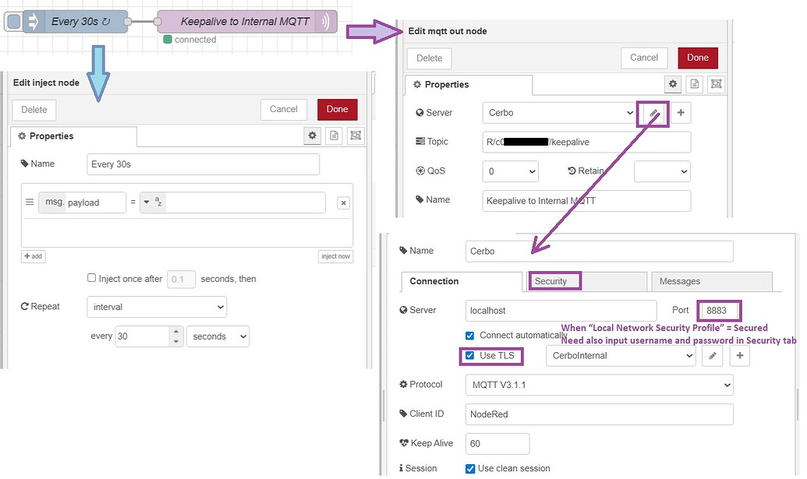

Here are a few Node-Red flows to share.  
  
**MQTT Keep-alive**  
This [flow](/Node-RED/Flows/MQTT-Keep-alive.json) needs to run inside the Victron Node-Red in order for the MQTT client to be able to receive MQTT topics periodically..  
  
